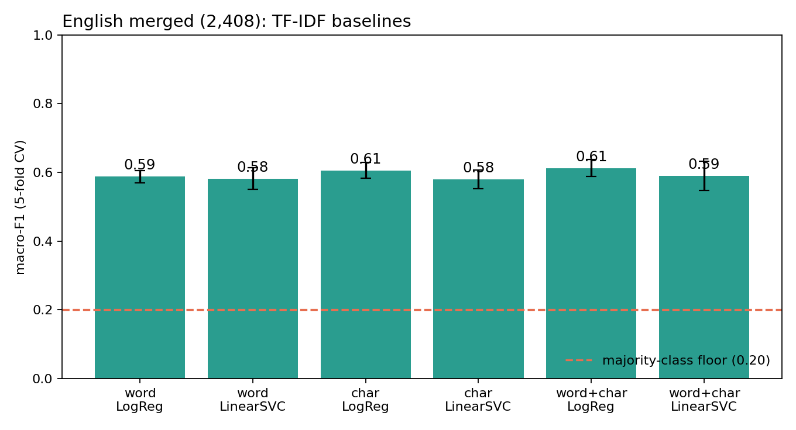
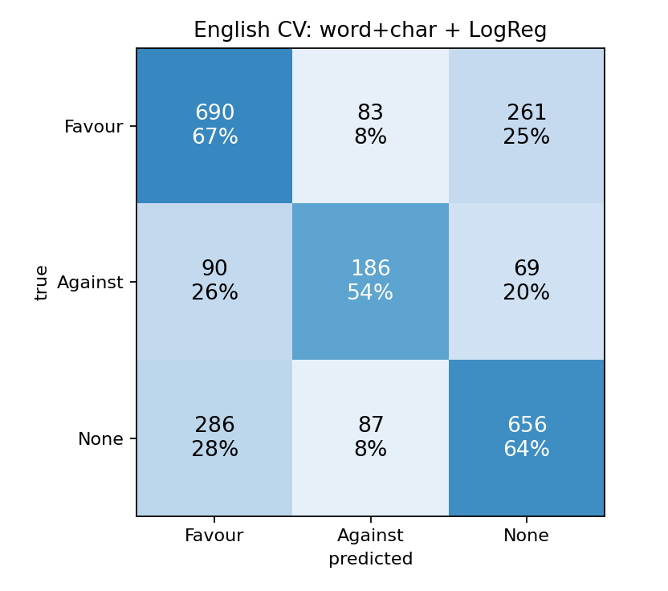
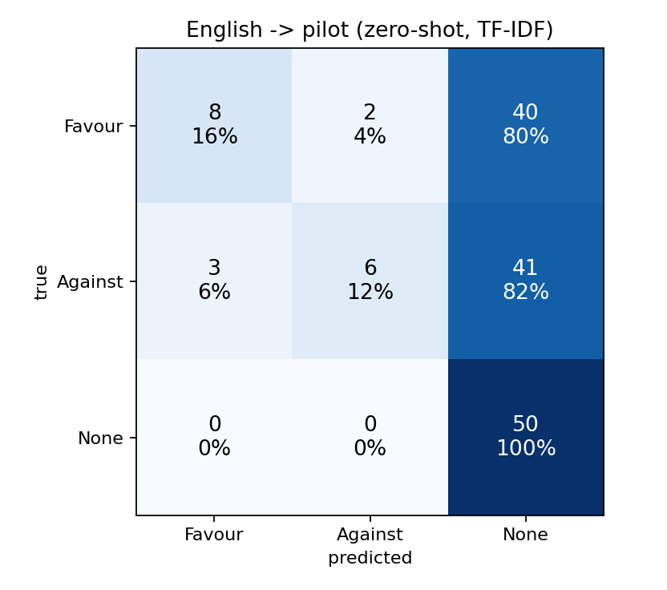

# Baseline results (generated by src/baseline.py)

TF-IDF (word 1-2 + char_wb 2-5) with LogisticRegression / LinearSVC, `class_weight='balanced'`, stratified 5-fold CV, seed 42. Floor = `DummyClassifier(most_frequent)`.

> **Caveats.** English CV mixes news sentences (GWSD) with tweets (SemEval); the files have no document ids, so sentences from one article may sit in different folds, and one conference hashtag (#CFCC15) forms a memorisable cluster. Treat A and B as optimistic. Section C/D use the **pilot corpus, development only - not comparable to official-set results** (150 synthetic rows).

## A. English merged, 5-fold CV (2,408 rows)

| features | model | macro-F1 (mean +- sd over folds) | accuracy |
|---|---|---|---|
| word | LogReg | 0.588 +- 0.018 | 0.606 |
| word | LinearSVC | 0.582 +- 0.031 | 0.612 |
| char | LogReg | 0.605 +- 0.023 | 0.631 |
| char | LinearSVC | 0.580 +- 0.027 | 0.616 |
| word+char | LogReg | 0.613 +- 0.025 | 0.636 |
| word+char | LinearSVC | 0.590 +- 0.042 | 0.627 |
| - | Dummy(majority) | 0.200 +- 0.000 | 0.429 |



Best: **word+char + LogReg**. Pooled out-of-fold classification report:

```
              precision    recall  f1-score   support

      Favour      0.647     0.667     0.657      1034
     Against      0.522     0.539     0.531       345
        None      0.665     0.638     0.651      1029

    accuracy                          0.636      2408
   macro avg      0.612     0.615     0.613      2408
weighted avg      0.637     0.636     0.636      2408

```



Macro-F1 of the pooled out-of-fold predictions by source: GWStance/GWSD 0.610, SemEval-2016 Task 6 0.602.

### Error analysis

* Largest confusion: true **None** predicted **Favour** (286 sentences). Examples: "Alarming levels of sea level rise are predicted to threaten Florida over the next decades." | "The Intergovernmental Panel on Climate Change should be clearer on how it draws conclusions from the body of r" | "Fighting global warming, the stated purpose of AB32, is a loser with California voters."
* Against recall 0.54; 69 Against sentences were called None.

### Why `class_weight='balanced'`

Same model, only the class weights changed: macro-F1 0.613 (balanced) vs 0.558 (unweighted); Against recall 0.54 vs 0.25. Macro-F1 averages per-class F1 with equal weight, so the rare Against class counts as much as the two large ones; unweighted training optimises overall error and under-serves it.

## B. English high-confidence (1,686 rows, agreement >= 0.75), same config

macro-F1 0.658 +- 0.035 (floor 0.213).

## C. Pilot hi+bn, 5-fold CV (pilot corpus, development only - not comparable to official-set results)

| features | model | macro-F1 (mean +- sd over folds) | accuracy |
|---|---|---|---|
| word | LogReg | 0.536 +- 0.049 | 0.540 |
| word | LinearSVC | 0.522 +- 0.059 | 0.527 |
| char | LogReg | 0.549 +- 0.023 | 0.547 |
| char | LinearSVC | 0.539 +- 0.049 | 0.540 |
| word+char | LogReg | 0.570 +- 0.071 | 0.567 |
| word+char | LinearSVC | 0.583 +- 0.042 | 0.587 |
| - | Dummy(majority) | 0.167 +- 0.000 | 0.333 |

150 rows with 30 per test fold: the standard deviations are large; use only to check the pipeline runs on Indic text.

## D. Zero-shot transfer: train on English (2,408) -> test on pilot (pilot corpus, development only - not comparable to official-set results)

* Config word+char + LogReg: **macro-F1 0.341**, accuracy 0.427 (majority floor on pilot = 0.167).
* Macro-F1 by language: bn 0.341, hi 0.340
* Accuracy by detected script (n): bn 0.36 (n=53), hi 0.36 (n=53), latin 0.50 (n=24), mixed 0.70 (n=20)
* Predicted class counts: {'Favour': 11, 'Against': 8, 'None': 131}



A TF-IDF model trained on English has almost no features in common with Devanagari/Bengali text, so it falls back on a prior. This is the cross-lingual gap that a multilingual encoder (MuRIL, XLM-R) is meant to close.
