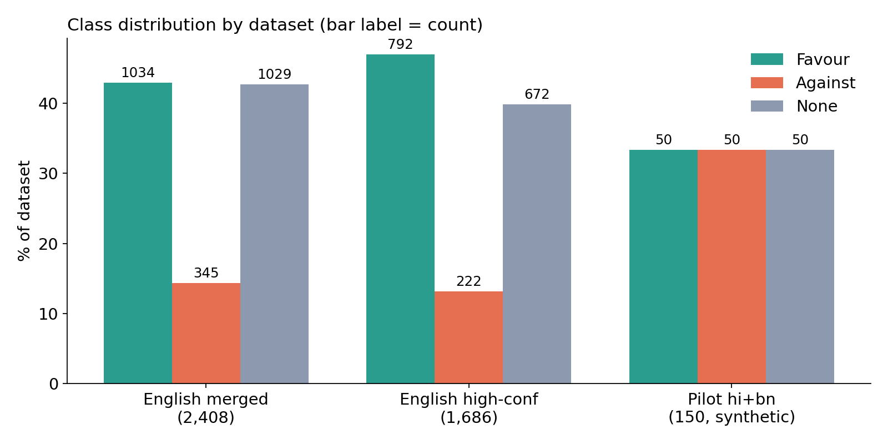
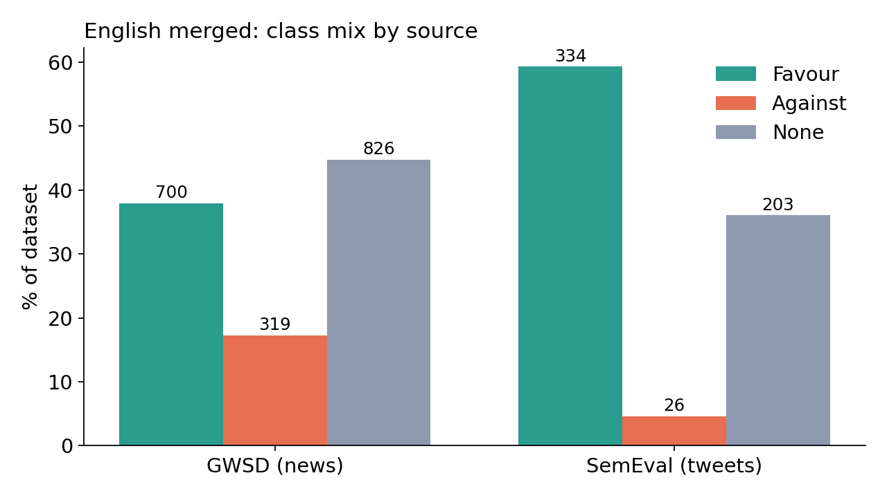
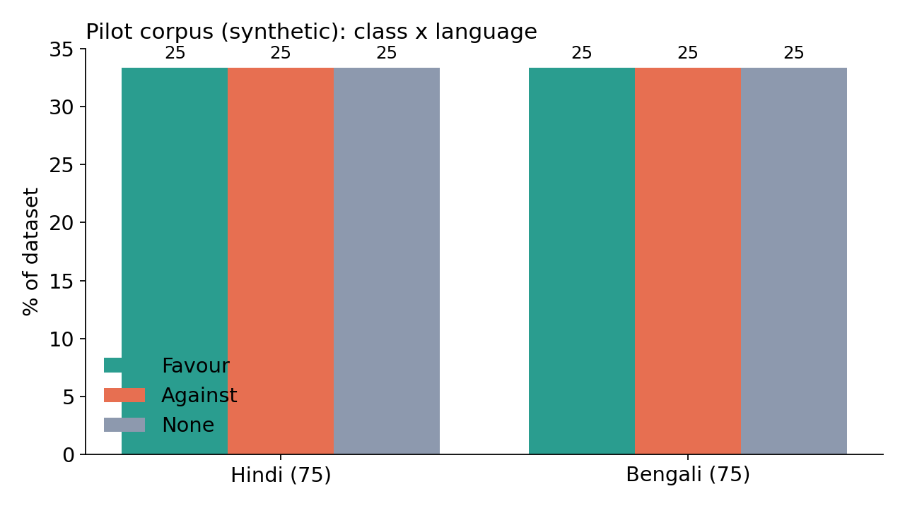
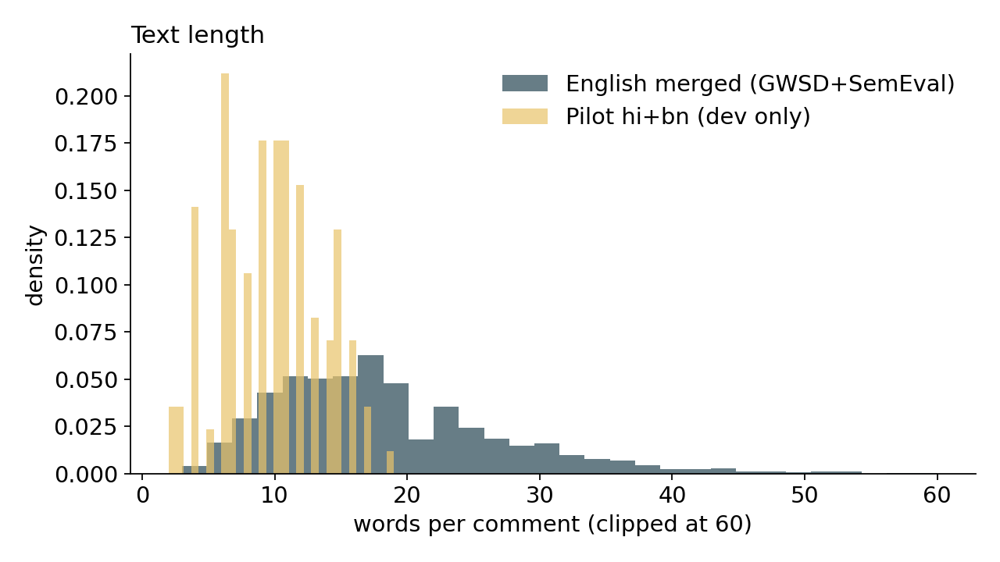
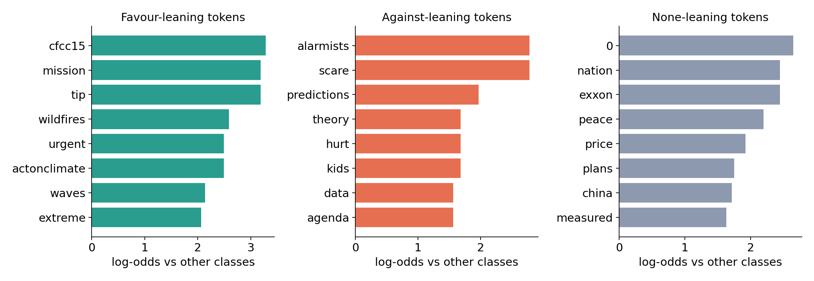

# Exploratory data analysis (generated by src/eda.py)

> Every number below was computed by `src/eda.py` on the files in this repo's `data/`. The pilot rows are a **team-authored pilot corpus, development only (synthetic, not scraped, not the official data)**; they must never be quoted as official-set results.

## 1. Datasets analysed

| dataset | rows | Favour / Against / None | chars mean/med/p95/max | words mean/med/p95/max | vocab | hapax rate | dup. comments | majority-class macro-F1 floor |
|---|---|---|---|---|---|---|---|---|
| English merged (GWSD+SemEval) | 2408 | 1034 / 345 / 1029 | 110.4 / 104 / 209 / 347 | 18.3 / 17 / 35 / 60 | 6221 | 54.3% | 0 | 0.2003 |
| English high-confidence | 1686 | 792 / 222 / 672 | 107.5 / 104 / 200 / 342 | 17.7 / 17 / 33 / 58 | 5205 | 57.1% | 0 | 0.2131 |
| Pilot hi+bn (dev only) | 150 | 50 / 50 / 50 | 52.3 / 54 / 80 / 104 | 9.6 / 10 / 16 / 19 | 790 | 68.4% | 0 | 0.1667 |

Tokens are lower-cased words after `preprocess.clean`, split with the Indic-aware `TOKEN` regex. *Hapax rate* = share of vocabulary types that occur exactly once.

## 2. External sources (not part of the training pool)

| file | rows | Favour / Against / None | median words | stance target | domain |
|---|---|---|---|---|---|
| semeval2016_climate_en | 564 | 335/26/203 | 16.0 | Climate Change is a Real Concern | tweets |
| dhoroni_bn_news | 2193 | 1586/137/470 | 331.0 | climate change (news article stance) | news articles (NOT social media) |
| multiclimate_en_video | 4144 | 1847/1176/1121 | 19.0 | climate change (video stance) | YouTube video transcript sentences (NOT comments) |
| swami_hinglish_demonetisation | 3545 | 964/647/1934 | 19.0 | demonetisation (NOT climate) | tweets |

Label mappings: SemEval favor/against/none; Dhoroni Positive/Negative/Neutral (Problematic dropped); MultiClimate support/oppose/neutral (**oppose = negative sentiment toward climate change itself, so the Against mapping is low-confidence**); Swami FAVOR/AGAINST/NONE are about **demonetisation**, not climate.

## 3. Class distribution

* **Against is the rare class everywhere that matters** (14.3% of the English merged set; 26 of 564 SemEval tweets). Macro-F1 weights Against as much as Favour, so ignoring it is expensive.
* The pilot corpus is balanced **by construction** (50/50/50, 75 Hindi + 75 Bengali); that is not a finding.

### Class mix by source (English merged)

| source | rows | Favour | Against | None |
|---|---|---|---|---|
| GWStance/GWSD (Luo et al. 2020), majority vote of 8 annotators | 1845 | 700 | 319 | 826 |
| SemEval-2016 Task 6 (via TweetEval) | 563 | 334 | 26 | 203 |

### Pilot: class x language and script

Script-based language ID on the pilot (rows = intended language, columns = detected script):

| language   |   bn |   hi |   latin |   mixed |
|:-----------|-----:|-----:|--------:|--------:|
| bn         |   53 |    0 |      12 |      10 |
| hi         |    0 |   53 |      12 |      10 |

Romanised Hindi/Bengali and English are both `latin` by script, so script ID alone cannot separate them.

### Pilot: phenomenon x class

| phenomenon   |   Favour |   Against |   None |
|:-------------|---------:|----------:|-------:|
| codemix      |        8 |         8 |      6 |
| emoji        |        4 |         4 |      4 |
| implicit     |        8 |         6 |      0 |
| negation     |        6 |         6 |      0 |
| offtopic     |        0 |         0 |     16 |
| plain        |       10 |        10 |      8 |
| question     |        2 |         4 |     10 |
| roman        |        8 |         8 |      6 |
| sarcasm      |        4 |         4 |      0 |

## 4. Annotator disagreement (GWStance)

* **Raw GWSD.tsv: 215 of 2,300 sentences (9.3%) have no unique majority label among their 8 annotators.** Deduplicating on comment text removed 13 of them, so 202 survive in the merged file (147 are 4-4 splits, 55 are 3-3-2).
* The tie rows are dropped from training and evaluation and kept in `data/gwstance_ambiguous_ties.csv`.
* Among the 1845 GWSD rows that kept a label, agreement has a median of 0.750 (min 0.500). The tie rate is a measured indication of annotator disagreement and task difficulty.
* SemEval rows (563) carry one published gold label and no agreement score.

## 5. Text length

## 6. Vocabulary and hapax rate

* English merged: vocab 6221, **hapax rate 54.3%**.
* Pilot (Hindi+Bengali+romanised): vocab 790, **hapax rate 68.4%** over only 1442 tokens.
* A high hapax rate means most word types are seen once: a word-level model has no statistics for them. Character n-grams share sub-word pieces across spelling variants, which is why `baseline.py` uses char_wb 2-5.

## 7. Frequent tokens

**English merged** (English stop-words removed): global (785), climate (679), warming (623), change (407), carbon (357), emissions (212), sea (183), ice (165), fossil (162), dioxide (132), world (124), temperatures (110), fuels (106), years (105), rise (101)

**Pilot** (no stop-word list, so function words appear): है (44), में (17), नहीं (17), ये (15), हैं (12), global (12), warming (12), का (10), hai (10), बहुत (9), साल (9), कोई (9), না (9), तो (8), की (8)

## 8. Class-discriminative tokens

English merged (smoothed log-odds, min count 8): **Favour**: cfcc15, mission, tip, wildfires, urgent, actonclimate; **Against**: alarmists, scare, predictions, theory, hurt, kids; **None**: 0, nation, exxon, peace, price, plans

Pilot (min count 3, pooled Hindi+Bengali): **Favour**: कि, रहा, ही, আছে, कुछ, को; **Against**: funding, ভয়, बात, ठंड, ki, নতুন; **None**: video, ভালো, দাদা, वीडियो, sir, आज

* The top Favour token `cfcc15` occurs in 21 rows, 100% of them Favour, nearly all from one source (SemEval-): an event-hashtag collection artefact, not a stance cue. Cross-validation will reward memorising such clusters, so English CV scores are optimistic.
* **58.9% of the vocabulary of Against sentences also occurs in Favour sentences** (English merged): the classes are separated by framing, negation and sarcasm, not by a disjoint word list.

## 9. Majority-class floor

| dataset | macro-F1 of always predicting the majority class |
|---|---|
| English merged (GWSD+SemEval) | 0.2003 |
| English high-confidence | 0.2131 |
| Pilot hi+bn (dev only) | 0.1667 |

Accuracy would look respectable (the majority share) while macro-F1 is near 0.2: this is why macro-F1 is the metric.
