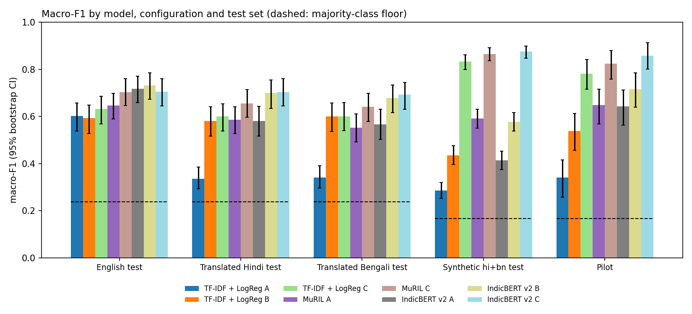
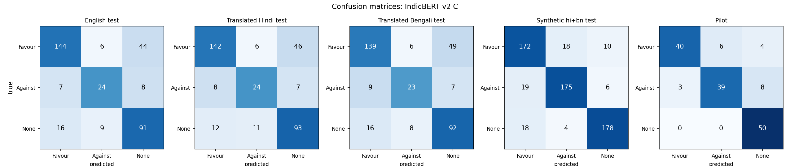

# Round 2 results (generated by src/evaluate.py from outputs/preds/)

Macro-F1 with 95% bootstrap confidence interval (1,000 resamples). Floor = always predicting the test set's majority class.

## Limitations (read first)

* The synthetic test set comes from the same generator as the synthetic training data, so configuration C's score on it is optimistic; configurations A and B, which never see synthetic data, are the fairer measure of transfer.
* No result here is a score on real Hindi/Bengali social-media comments: Indic test sets are machine-translated English (GWSD news sentences and SemEval tweets), synthetic (LLM-generated) comments, or the 150-row synthetic pilot.
* Translated test labels are the English labels carried over; translation can change stance (team review pending).
* The English test set has few Against rows, so per-class Against scores on it are noisy.
* The judge filter keeps only synthetic comments that a second LLM labels as intended, removing the most ambiguous ones (most of all sarcasm), so the synthetic test set is easier than real comments would be.
* The 150-row pilot is also synthetic comment-style text (team-authored), so it partly favours configuration C too.
* Single training seed; differences inside overlapping confidence intervals are not established.
* Synthetic test labels are not yet human-verified (data/review/synthetic_test_review.csv).

## Main table: macro-F1 [95% CI]

| Model | Config | English test (n=349) | Translated Hindi test (n=349) | Translated Bengali test (n=349) | Synthetic hi+bn test * (n=600) | Pilot (n=150) |
|---|---|---|---|---|---|---|
| TF-IDF + LogReg | A_english | 0.602 [0.54-0.66] | 0.335 [0.29-0.38] | 0.341 [0.30-0.39] | 0.285 [0.25-0.32] | 0.341 [0.26-0.41] |
| TF-IDF + LogReg | B_translated | 0.592 [0.53-0.65] | 0.580 [0.52-0.64] | 0.600 [0.54-0.66] | 0.435 [0.40-0.48] | 0.537 [0.46-0.61] |
| TF-IDF + LogReg | C_full | 0.631 [0.57-0.69] | 0.600 [0.54-0.65] | 0.600 [0.54-0.66] | 0.832 [0.80-0.86] | 0.781 [0.72-0.84] |
| MuRIL | A_english | 0.646 [0.59-0.70] | 0.586 [0.53-0.64] | 0.552 [0.49-0.61] | 0.592 [0.55-0.63] | 0.647 [0.57-0.71] |
| MuRIL | C_full | 0.704 [0.65-0.76] | 0.655 [0.60-0.71] | 0.641 [0.58-0.70] | 0.864 [0.84-0.89] | 0.824 [0.76-0.88] |
| IndicBERT v2 | A_english | 0.717 [0.66-0.77] | 0.581 [0.52-0.64] | 0.566 [0.50-0.63] | 0.414 [0.37-0.45] | 0.643 [0.56-0.71] |
| IndicBERT v2 | B_translated | 0.732 [0.67-0.79] | 0.700 [0.63-0.75] | 0.678 [0.62-0.73] | 0.577 [0.54-0.62] | 0.715 [0.64-0.78] |
| IndicBERT v2 | C_full | 0.705 [0.64-0.76] | 0.703 [0.64-0.76] | 0.693 [0.63-0.74] | 0.875 [0.85-0.90] | 0.858 [0.80-0.91] |
| Majority floor | - | 0.238 | 0.238 | 0.238 | 0.167 | 0.167 |

\* synthetic test labels not yet human-verified.

## Accuracy

| Model | Config | English test | Translated Hindi test | Translated Bengali test | Synthetic hi+bn test | Pilot |
|---|---|---|---|---|---|---|
| TF-IDF + LogReg | A_english | 0.625 | 0.470 | 0.476 | 0.392 | 0.427 |
| TF-IDF + LogReg | B_translated | 0.625 | 0.625 | 0.645 | 0.487 | 0.587 |
| TF-IDF + LogReg | C_full | 0.656 | 0.636 | 0.650 | 0.832 | 0.787 |
| MuRIL | A_english | 0.668 | 0.613 | 0.570 | 0.610 | 0.667 |
| MuRIL | C_full | 0.736 | 0.691 | 0.682 | 0.865 | 0.827 |
| IndicBERT v2 | A_english | 0.745 | 0.679 | 0.673 | 0.458 | 0.647 |
| IndicBERT v2 | B_translated | 0.765 | 0.756 | 0.725 | 0.613 | 0.733 |
| IndicBERT v2 | C_full | 0.742 | 0.742 | 0.728 | 0.875 | 0.860 |

## Comparison 1: models on the same data (macro-F1)

* **A_english**: English test: TF-IDF + LogReg 0.602, MuRIL 0.646, IndicBERT v2 0.717; Translated Hindi test: TF-IDF + LogReg 0.335, MuRIL 0.586, IndicBERT v2 0.581; Translated Bengali test: TF-IDF + LogReg 0.341, MuRIL 0.552, IndicBERT v2 0.566; Synthetic hi+bn test: TF-IDF + LogReg 0.285, MuRIL 0.592, IndicBERT v2 0.414; Pilot: TF-IDF + LogReg 0.341, MuRIL 0.647, IndicBERT v2 0.643
* **B_translated**: English test: TF-IDF + LogReg 0.592, IndicBERT v2 0.732; Translated Hindi test: TF-IDF + LogReg 0.580, IndicBERT v2 0.700; Translated Bengali test: TF-IDF + LogReg 0.600, IndicBERT v2 0.678; Synthetic hi+bn test: TF-IDF + LogReg 0.435, IndicBERT v2 0.577; Pilot: TF-IDF + LogReg 0.537, IndicBERT v2 0.715
* **C_full**: English test: TF-IDF + LogReg 0.631, MuRIL 0.704, IndicBERT v2 0.705; Translated Hindi test: TF-IDF + LogReg 0.600, MuRIL 0.655, IndicBERT v2 0.703; Translated Bengali test: TF-IDF + LogReg 0.600, MuRIL 0.641, IndicBERT v2 0.693; Synthetic hi+bn test: TF-IDF + LogReg 0.832, MuRIL 0.864, IndicBERT v2 0.875; Pilot: TF-IDF + LogReg 0.781, MuRIL 0.824, IndicBERT v2 0.858

## Comparison 2: what translated (B) and synthetic (C) data add (macro-F1 change vs A)

* TF-IDF + LogReg B_translated vs A: English test -0.010, Translated Hindi test +0.245, Translated Bengali test +0.259, Synthetic hi+bn test +0.151, Pilot +0.197
* TF-IDF + LogReg C_full vs A: English test +0.030, Translated Hindi test +0.265, Translated Bengali test +0.259, Synthetic hi+bn test +0.548, Pilot +0.441
* MuRIL C_full vs A: English test +0.057, Translated Hindi test +0.069, Translated Bengali test +0.090, Synthetic hi+bn test +0.272, Pilot +0.176
* IndicBERT v2 B_translated vs A: English test +0.015, Translated Hindi test +0.119, Translated Bengali test +0.112, Synthetic hi+bn test +0.163, Pilot +0.072
* IndicBERT v2 C_full vs A: English test -0.012, Translated Hindi test +0.122, Translated Bengali test +0.127, Synthetic hi+bn test +0.461, Pilot +0.215

## Comparison 3: English test vs Indic test sets (cross-lingual loss)

| Model | Config | English | mean of translated hi/bn + pilot | difference |
|---|---|---|---|---|
| TF-IDF + LogReg | A_english | 0.602 | 0.339 | -0.263 |
| TF-IDF + LogReg | B_translated | 0.592 | 0.572 | -0.020 |
| TF-IDF + LogReg | C_full | 0.631 | 0.660 | +0.029 |
| MuRIL | A_english | 0.646 | 0.595 | -0.051 |
| MuRIL | C_full | 0.704 | 0.707 | +0.003 |
| IndicBERT v2 | A_english | 0.717 | 0.597 | -0.120 |
| IndicBERT v2 | B_translated | 0.732 | 0.698 | -0.035 |
| IndicBERT v2 | C_full | 0.705 | 0.751 | +0.046 |

## Best run: IndicBERT v2 C (indicbert_C_full)

Selection rule: highest mean macro-F1 on translated Hindi, translated Bengali and pilot test sets (the synthetic test set is excluded because configuration C trains on data from the same generator).

| Test set | Class | Precision | Recall | F1 | Support |
|---|---|---|---|---|---|
| English test | Favour | 0.862 | 0.742 | 0.798 | 194 |
| English test | Against | 0.615 | 0.615 | 0.615 | 39 |
| English test | None | 0.636 | 0.784 | 0.703 | 116 |
| Translated Hindi test | Favour | 0.876 | 0.732 | 0.798 | 194 |
| Translated Hindi test | Against | 0.585 | 0.615 | 0.600 | 39 |
| Translated Hindi test | None | 0.637 | 0.802 | 0.710 | 116 |
| Translated Bengali test | Favour | 0.848 | 0.717 | 0.776 | 194 |
| Translated Bengali test | Against | 0.622 | 0.590 | 0.605 | 39 |
| Translated Bengali test | None | 0.622 | 0.793 | 0.697 | 116 |
| Synthetic hi+bn test | Favour | 0.823 | 0.860 | 0.841 | 200 |
| Synthetic hi+bn test | Against | 0.888 | 0.875 | 0.882 | 200 |
| Synthetic hi+bn test | None | 0.917 | 0.890 | 0.904 | 200 |
| Pilot | Favour | 0.930 | 0.800 | 0.860 | 50 |
| Pilot | Against | 0.867 | 0.780 | 0.821 | 50 |
| Pilot | None | 0.806 | 1.000 | 0.893 | 50 |

### Macro-F1 by language

* Synthetic hi+bn test: bn 0.858, hi 0.893
* Pilot: bn 0.837, hi 0.879
* Translated Hindi test: 0.703
* Translated Bengali test: 0.693

### Accuracy by phenomenon

| Test set | Phenomenon | Accuracy | n |
|---|---|---|---|
| Synthetic hi+bn test | codemix | 0.874 | 87 |
| Synthetic hi+bn test | emoji | 0.904 | 52 |
| Synthetic hi+bn test | implicit | 0.900 | 50 |
| Synthetic hi+bn test | negation | 0.840 | 50 |
| Synthetic hi+bn test | neutral_fact | 0.960 | 25 |
| Synthetic hi+bn test | offtopic | 0.966 | 29 |
| Synthetic hi+bn test | plain | 0.890 | 154 |
| Synthetic hi+bn test | question | 0.955 | 22 |
| Synthetic hi+bn test | roman | 0.796 | 93 |
| Synthetic hi+bn test | sarcasm | 0.816 | 38 |
| Pilot | codemix | 1.000 | 22 |
| Pilot | emoji | 0.833 | 12 |
| Pilot | implicit | 0.571 | 14 |
| Pilot | negation | 1.000 | 12 |
| Pilot | offtopic | 1.000 | 16 |
| Pilot | plain | 0.964 | 28 |
| Pilot | question | 0.875 | 16 |
| Pilot | roman | 0.727 | 22 |
| Pilot | sarcasm | 0.500 | 8 |

Misclassified examples for error analysis: `outputs/error_examples.csv` (15 rows, grouped by phenomenon).

## Training runs

| Run | Train rows | Best val macro-F1 | Best epoch | Minutes | Device |
|---|---|---|---|---|---|
| tfidf_A_english | 1750 | 0.630 | - | 0.0 | cpu |
| tfidf_B_translated | 5250 | 0.606 | - | 0.1 | cpu |
| tfidf_C_full | 7251 | 0.683 | - | 0.1 | cpu |
| muril_A_english | 1750 | 0.630 | 5 | 1.0 | NVIDIA GeForce RTX 5050 Laptop GPU |
| muril_C_full | 7251 | 0.756 | 3 | 3.8 | NVIDIA GeForce RTX 5050 Laptop GPU |
| indicbert_A_english | 1750 | 0.662 | 5 | 1.0 | NVIDIA GeForce RTX 5050 Laptop GPU |
| indicbert_B_translated | 5250 | 0.674 | 4 | 3.0 | NVIDIA GeForce RTX 5050 Laptop GPU |
| indicbert_C_full | 7251 | 0.753 | 3 | 4.1 | NVIDIA GeForce RTX 5050 Laptop GPU |

Validation scores are not comparable across configurations: each configuration selects on its own validation data.
